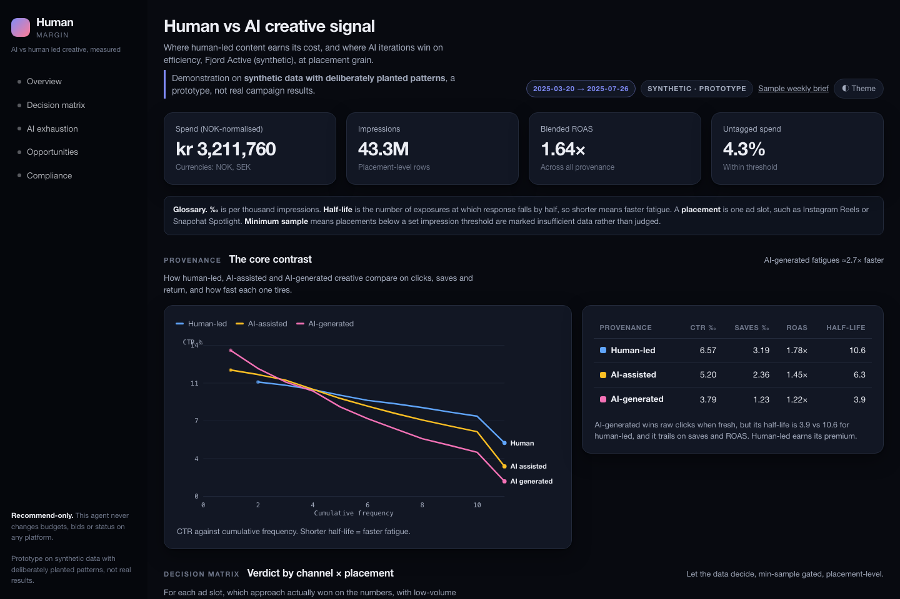

# Human Margin

**AI vs human led creative, measured**

**Human Margin is a sanity checker for Norwegian B2C media buyers** weighing
AI-led, hybrid and human-led creative. It gives one advertiser more information
than they could gather alone, then leaves the decision to them: every output
compares and describes, [none instructs](docs/principles.md). It never changes
budgets, bids or ad status. Working today: data ingestion, creative tagging and a
prototype dashboard. In development: the AI-exhaustion engine and the
creative-approach planner.

**Live demo** → https://jokelhar.github.io/human-margin/ (runs on synthetic data)

[](https://jokelhar.github.io/human-margin/)

It keeps every platform export at the level of the individual placement, never
rolled up, and is being built to answer two questions with evidence rather than
opinion: where human-led creative earns its higher cost, and where the next
distinctly-human opportunities are. The AI-exhaustion detection behind the
first, and the planner that weighs AI against hybrid and human-led creative, are
in development; see the status table below.


## Demo

> **Live demo dashboard** → https://jokelhar.github.io/human-margin/
> A prototype console rendering the human-vs-AI decision matrix
> with exhaustion and forward-pattern alerts, on **synthetic** Norwegian data in
> which the patterns are deliberately planted.

<!-- [[PLACEHOLDER: add a GIF or screenshot of the planner wizard here once Phase 7 lands]] -->

## Why I built this

I led marketing for a portfolio of 20-odd brands in Oslo, and I reported the numbers. This is the beta of a tool I started to notice I was lacking, something to contextualise creative decisions within a larger market perspective, which could account and tangentially predict AI fatigue among potential customers.

The temptation is always the same: let AI iterate the copy, the creative, the UGC. The reason is cost. Even with a lower ROAS, the savings against a human-led workflow make AI tempting, and far easier to justify on a thin budget. Whether it wins the audience is another matter, and that rarely gets measured.

Feeds fill up with content that looks the same, and audiences learn to scroll past it. That cost never appears on the production invoice. Neither does the damage to a brand that starts to look like slop.

This tool replaces the guess with evidence. It tracks where AI creative is wearing thin, where human-led work still earns its cost, and what a given campaign should do with the budget it actually has. It's built for marketers, and for business owners who want data to protect their brand before they sign an agency quote.

I built it with Claude Code, and that's the point. I use Claude daily. AI should make our decisions better informed and our iterations faster. It shouldn't make the creative call. Going into 2027, the edge belongs to teams who know where AI earns its place and where a human idea is still worth paying for.

Try it, break it, and tell me where the benchmarks are wrong and what the results mean in your industry.

João Harrison, Oslo

## Quick start

No ad accounts and no API keys required: it runs fully offline on synthetic
data. Requires Python 3.11+ and [uv](https://docs.astral.sh/uv/).

```bash
uv sync                 # virtual environment + dependencies
uv run pytest -q        # 40 tests
```

End-to-end on synthetic data (generate → analyse → dashboard → report):

```bash
uv run python scripts/generate.py --out data/synthetic.duckdb --accounts 1 --days 180
uv run python scripts/demo_insights.py          # -> out/insights.json
uv run python scripts/build_dashboard.py        # -> docs/index.html (the live demo)
uv run python scripts/weekly_report.py          # Markdown weekly brief to stdout
```

A rendered example brief lives at [`samples/weekly_report_sample.md`](samples/weekly_report_sample.md).

## A worked example, in plain language

Say you run ads for a skincare brand. You've been leaning on AI-generated video
because it's cheap to churn out. The agent takes your exported numbers (kept at
the level of each individual *placement*: Instagram Reels, Snapchat Spotlight,
and so on, never blurred together) and shows you, for example:

- **AI creative wins the first clicks but fades faster.** On synthetic data the
  AI-generated ads start with a strong click rate and then tire quickly, a
  "half-life" of about 4 days against roughly 10 for human-led, while human-led
  content keeps earning saves and conversions for longer.
- **Different placements want different creative.** Lo-fi, human UGC does its
  best work in Stories and Reels; polished studio work holds up better in Feed.
- **Not all AI is the same.** The agent separates kinds of AI: product mock-ups
  (AA-PRD) behave close to human-led in feed, while synthetic UGC (AG-UGC) tires
  fastest and draws the most "this is AI" comments.
- **Some of your spend is on creative nobody has labelled.** The agent reports
  that as a share of your budget, so you can see what's unlabelled, rather than
  guessing what it was.

These figures are not real findings: the ~4-day versus ~10-day half-life comes
from synthetic data in which the generator deliberately plants that pattern, and
the point of the example is that the method recovers what was planted.

Every figure comes with how much it rests on your own data versus a benchmark or
an assumption, so you know how hard to lean on it. The planner (in progress)
takes this further: you enter a budget, a price and a few campaign details, and
it tells you whether AI, hybrid or human-led is the better bet, with the
break-even spelled out ("human-led needs to beat AI by X% to pay off").

## Licences

This repository is **dual-licensed**:

| Part of the repo | Licence |
|---|---|
| Source code (`src/`, `tests/`, `scripts/`, `web/`) | [Apache-2.0](LICENSE) |
| Benchmark library (`data/benchmarks/`) and documentation | [CC BY 4.0](LICENSE-DATA) |

See [`THIRD_PARTY_LICENSES.md`](THIRD_PARTY_LICENSES.md) for dependency licences
(all permissive) and [`DATA_SOURCES.md`](DATA_SOURCES.md) for how benchmark
figures are cited.

**Name and trademark.** The Apache-2.0 licence covers the code, not the
project's name or logo. You're very welcome to fork and build on this. Please
just give your fork its own name rather than "Human Margin", so nobody
confuses the two. (See `NOTICE`.)

**How to cite.** Citation metadata is in [`CITATION.cff`](CITATION.cff); GitHub
shows a "Cite this repository" button from it.

## Disclaimer

This is **decision-support software, not a guarantee of results.** Benchmarks are
estimates, often drawn from proxy markets and clearly-labelled assumptions, and
every recommendation is designed to ship with an evidence grade so you can see
how far to trust it. The agent is **recommend-only**: it never changes budgets, bids or ad status,
never launches experiments, and never touches your ad accounts. All data stays on
your machine; there is no telemetry. Nothing here is financial advice.

Built with [Claude Code](https://claude.com/claude-code).

---

## Status

| Phase | Scope | State |
|---|---|---|
| **1** | Unified placement-grain schema + synthetic data generator | ✅ complete |
| **2** | CSV mappers (Meta, Snapchat, TikTok, YouTube) behind a `DataSource` interface | ✅ complete |
| **3** | Tagging: provenance (human **and AI** sub-types), Norwegian-ness (trust hierarchy) + untagged-spend reporting | ✅ complete |
| 4 | Exhaustion module, mixed-effects stats, breakdowns | ⏸ on hold |
| 5 | Norwegian sentiment / AI-callout detection | ◻ |
| 6–10 | Decision matrix, patterns, halo, recommendations, API connectors | ◻ |

Also in progress, as a parallel module: the **Creative Approach Planner**
(AI vs hybrid vs human), a standalone, offline planner backed by a cited
benchmark library, which sharpens its estimates with the exhaustion framework
once account data exists. **Try it in the browser (no install):**
[the planner demo](https://jokelhar.github.io/human-margin/planner.html) runs the
real engine locally via Pyodide, with four worked examples as the instant view.

**Phases 1–3 and 5 are in.** The input schema, scenario YAML and currency
handling; the versioned **benchmark library** (`data/benchmarks/`) with
market-similarity weighting (Norway → Nordics → wider EU/UK → global) and the
two-effect human-vs-AI priors (response at parity, a modest human memory/brand
edge, cited); a **content-format dimension** (static, short video, UGC talking
head, studio, AI mock-up) with per-format priors and a per-(format × approach)
**production-cost matrix** (`config/planner/formats.yaml`); and the **decision
engine** itself — it reports, as a *position* never a pick, which approach
delivers the most conversions per krone, the **break-even** response lift a
higher-cost approach would need, a separate (not-in-funnel) **brand line**, and
what the answer hinges on (sensitivity). Uncertainty is propagated by Monte Carlo
over triangular ranges (fixed seed; p10/p50/p90), not by multiplying lows and
highs. The **agency-quote check** places a quote's fees against typical practice.
A day-one **public-context layer** can show dated Meta Ad Library ad-volume
snapshots (official API only, within terms; see `DATA_SOURCES.md`). Every figure
cites a source or is a labelled assumption or expert-estimate slot; none are
invented.

```bash
uv run python scripts/plan.py --all          # full recommendation for the example scenarios
uv run python scripts/plan.py scenarios/examples/club_night.yaml --format ugc_talking_head
uv run python scripts/build_planner_demo.py  # build the in-browser demo (web/ and docs/)
uv run python scripts/assumptions.py         # every assumption + expert slot and what replaces it
uv run python scripts/refresh_benchmarks.py  # flag benchmark entries over 18 months old
```

**Evidence tags.** Every figure carries a provenance tier so it is clear what
rests on real data and what is still a placeholder: **Your data** · **pooled
similar accounts** · **public benchmark (market · year)** · **Assumption**, with
a grade (A–D) and a wider range when the evidence is distant or old. See
[`docs/principles.md`](docs/principles.md) for the principle and the answer
shape, and `scripts/assumptions.py` for the full assumptions register.

A preview of forward **patterns** is also in: the dashboard's calendar patterns
are config-driven and each names an advertiser category, a moment and a time
window, then what has happened in that window and the evidence behind it (naming
the AI sub-type where relevant). Descriptive, never advice. This is a preview, not
the full Phase-7 engine.

Every remaining module exists as a documented stub (`src/mediekjop/*/__init__.py`).

## Scope: Norwegian *consumer*, not Norwegian *locality*

The unit of relevance is the **Norwegian consumer**. A Norwegian buying in
EUR/USD/GBP from a foreign advertiser is in scope. Therefore:

- **Currency is multi-currency**, normalised to **NOK** for reporting via a dated
  FX layer (`fx_rate`). Original transaction currency is preserved.
- **Creative language is not a filter.** English-language ads reaching Norwegian
  consumers are first-class.
- **"Norwegian-ness"** (language, dialect, locations, faces, cultural refs) is a
  **descriptive analytical dimension**: something tested as an explanatory
  variable, never an inclusion filter.

## Ingesting real platform exports

The Phase 2 path, using the included samples:

```python
from mediekjop.ingest import SPECS, CsvDataSource, ingest_into_db, const_fx
from mediekjop.schema import database

con = database.connect("data/account.duckdb")
sources = [CsvDataSource(SPECS[p], f"samples/exports/{f}") for p, f in {
    "meta": "meta_ads_export.csv", "snapchat": "snapchat_ads_export.csv",
    "tiktok": "tiktok_ads_export.csv", "youtube": "google_ads_youtube_export.csv",
}.items()]
account = {"account_id": "acc1", "account_name": "Demo", "brand": "demo", "home_currency": "NOK"}
ingest_into_db(con, sources, account, fx_lookup=const_fx({"EUR": 11.5}), tag=True)
```

## Architecture

```
ingest (DataSource: CSV now, API later) → unified placement-grain schema → DuckDB
   → tagging → exhaustion / sentiment / patterns / measurement → recommend → report + dashboard
```

- **One schema, defined once** in [`schema/ddl.py`](src/mediekjop/schema/ddl.py) as
  `TableSpec` objects; DuckDB DDL and the loaders' column order are both derived
  from it, so they cannot drift.
- **Ingestion is declarative.** A platform is a `MappingSpec`
  ([`ingest/specs.py`](src/mediekjop/ingest/specs.py)): a column map plus placement map,
  consumed by one generic `CsvMapper`. Adding a platform is a spec, not new code.
  The `DataSource` protocol is the seam that lets API connectors (Phase 10) swap in.
- **Recommend-only** is structural: no module can call a platform write API.

### Platform mapping coverage (Phase 2)

| Platform | Export | Click metric | Placements mapped | Currency |
|---|---|---|---|---|
| Meta | Ads Manager (Placement × Age) | Link clicks | FB/IG feed, reels, stories | spend column (NOK) |
| Snapchat | Ads Manager | Swipes | Snap Stories, Spotlight | Currency column |
| TikTok | Ads Manager | Clicks | TikTok feed | constant (NOK) |
| YouTube | Google Ads report | Clicks | Shorts, in-stream | Currency column (e.g. EUR → NOK) |

## The tagging naming convention

Provenance is tagged at source via tokens in the ad/post name (never inferred from
performance). Tokens are underscore-delimited, e.g.:

```
Vinterkos_HL-UGC_NO-loc_NO-dia_lang-dia_v3
```

| Token | Meaning |
|---|---|
| `HL-UGC` `HL-CRE` `HL-STF` `HL-DOC` `HL-STU` | human-led + sub-type (ugc / creator / staff_founder / documentary / studio_polished) |
| `AA` `AA-PRD` `AA-CPY` | ai_assisted (human concept, AI in production); optional sub-type product_imagery / copy_variants. Plain `AA` is untyped |
| `AG` `AG-UGC` `AG-SCN` | ai_generated (concept/core visuals by AI); optional sub-type synthetic_ugc / synthetic_scene. Plain `AG` is untyped |
| `NO-loc` `NO-face` `NO-cult` `NO-dia` | recognisable Norwegian locations / faces / cultural refs / dialect present |
| `lang-bok` `lang-nyn` `lang-dia` `lang-eng` `lang-mix` | language of the creative |

**Trust hierarchy (Phase 3, implemented).** Several sources may have an opinion
about one creative: the ad name, a buyer-supplied CSV override, a platform's
self-declared AI label, a C2PA content-credential manifest. Each speaks a common
`TagEvidence`, and the resolver merges them **field by field** in trust order
`naming_convention → csv_override → platform_label → c2pa`: the highest-trust
source with an opinion on a field wins it, so a disciplined ad name can set
provenance while a lower source still fills a gap (e.g. `dialect_region`) the
name left blank. `tag_source` and `tag_confidence` record which source decided
the headline provenance. Anything no source speaks to stays **untagged** and is
reported as a **share of total NOK spend** against
`thresholds.untagged_spend_warn_share`, never guessed from performance.

```python
from mediekjop import tagging
tagging.apply_to_db(con)                 # naming convention + optional overrides
rep = tagging.untagged_spend(con)
print(rep.untagged_share, rep.over_threshold)
```

The tagging module is the exact inverse of the naming convention the synthetic
generator uses to *encode* provenance into ad names. A round-trip test recovers
the generator's ground-truth tags from the names alone, with no access to the
performance tables.

## Data model (placement grain)

Dimensions: `account`, `campaign`, `placement`, `audience_segment`, `creative`
(carries provenance + Norwegian-ness), `date_dim`, `fx_rate`. Facts:
`ad_performance`, `organic_performance` (both placement grain), `comment` (author
identity stored only as a salted hash, for GDPR).

## What the synthetic generator encodes

So later phases have real signal to recover (ground truth is written to
`ground_truth.json`, never into the performance tables):

- Fatigue curves where **AI creative decays faster** at equal frequency, faster
  still in **younger cohorts**; some segments have a *widening* gap over time
  (true exhaustion) vs others a *stable* gap (quality difference).
- **Placement affinity**: UGC/lo-fi wins in Stories/Spotlight/Reels;
  studio-polished wins in Feed/in-stream.
- **Engagement-quality contrast**: AI wins clicks/likes, loses saves/shares.
- **AI sub-type differences**: product mock-ups (AA-PRD) sit close to human-led in
  feed; synthetic UGC (AG-UGC) fatigues fastest, saves worst and draws the most
  AI-callout comments (recorded in `ground_truth.json`).
- Multi-currency campaigns, seasonality around Norwegian calendar moments,
  organic posts, and comments (some carrying AI-callout language).

## Known limitations

- **Ad-library coverage (verified Nov 2026):** TikTok's Commercial Content Library
  covers Norway via the EEA; Meta's full *commercial* ad archive likely does
  **not** (Norway is EEA but not EU). Expect manual export for Meta
  category-saturation. Confirm against each platform's own docs.
- The demo dashboard uses **descriptive aggregates** and simple log-linear decay
  fits, not the Phase-4 hierarchical/Bayesian engine. It is labelled a prototype.
- Halo measurement (Phase 8) cannot use user-level paths (privacy); it relies on
  geo holdouts, sequencing and time-series, reported with uncertainty.
- The saturation index is a **directional estimate** only, shown with its
  estimated classifier accuracy, never as a competitor league table.

## Compliance surfaced in reports

- **Markedsføringsloven** (the Marketing Control Act): advertising labelling,
  especially creator/influencer and boosted organic content.
- **Kroppspress-merking**: `ai_assisted`/`ai_generated` creatives showing people
  are flagged for retouch-labelling review (`shows_people` on `creative`).
- **Platform AI-disclosure** (Meta, TikTok).
- **GDPR**: aggregated performance only; commenter identities hashed before
  storage; competitor data limited to what public ad libraries expose.

## Contributing

Benchmark figures with good sources are as welcome as code. See
[`CONTRIBUTING.md`](CONTRIBUTING.md) (we use the DCO; sign off commits with
`git commit -s`) and the [`Code of Conduct`](CODE_OF_CONDUCT.md). Security
reports: [`SECURITY.md`](SECURITY.md).

## Tech

Python 3.11+ · pandas · DuckDB · (statsmodels/PyMC from Phase 4) · pytest · uv.
The Python package is named `mediekjop` (Norwegian for media buying).
Config is one file: [`config/config.yaml`](config/config.yaml). Credentials come
only from environment variables, never logged, never committed.
